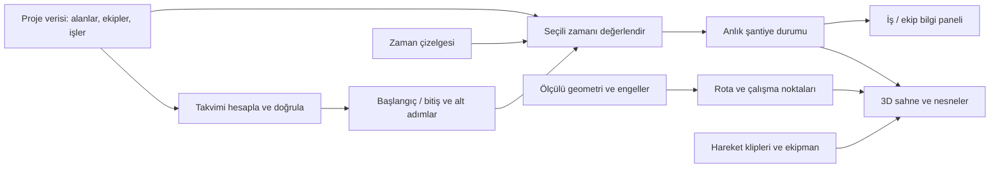

# Kod mimarisi

## Ana karar

İşin ne zaman ve nerede yapıldığı ile ekranda nasıl göründüğü ayrıdır. Aynı proje ve seçili zaman, aynı şantiye durumunu üretir. Kamera, FPS veya animasyon döngüsü işin tamamlanma tarihini değiştiremez.

Takvim → anlık durum akışı çalışır. Tek alanın 3D inceleme sahnesi de çalışır; henüz takvim anlık durumuna bağlı değildir. Rota ve tam iş takvimi arayüzü sözleşme/tasarım düzeyindedir.

## Katmanlar

1. **`domain`**: Three.js veya HTML bilmeyen veri sözleşmeleri, meslekler, hareket adları ve iş tarifleri. Meslek (`electrician`) ile hareket (`pull-cable`) farklı kavramlardır.
2. **`data`**: Projeye özgü alan, ekip, nesne ve görev kayıtları. M1–M9 kimlikleri burada; metrik geometri daha sonra ayrı bir sahne verisi olacak.
3. **`simulation`**: Saf takvim ve durum hesabı. Bağımlılıkları çözer, kaynak/usta çakışmalarını reddeder ve seçili zamandaki sonuçları hesaplar.
4. **`app`**: Veriyi sahiplenir; arayüzün zamanı değiştirmesi ve yeni programı değerlendirmesi için küçük bir giriş noktası sağlar.
5. **`presentation`**: Snapshot'ı 3D nesnelere ve arayüze çevirir. Onaylı modelin bağlantısı burada bulunur. Sahne nesneleri domain içine sızmaz.
6. **`navigation`**: Fiziksel geometri, geçişler ve geçici kapanmalara göre rota üretme sınırı. Henüz uygulama yok; yalnızca sözleşme var.

Bu yapı tek uygulamadır. Başlangıçta sunucu, veritabanı, mikroservis, ECS veya genel amaçlı eklenti sistemi yoktur.

## Üç ayrı zaman

- **Proje zamanı:** İlk günün 00:00 anından itibaren dakika. Örnekte `480`, 1. gün 08:00'dır. Takvimi ileri/geri taşıyan değer budur.
- **Çalışma süresi:** Yalnızca vardiya içinde ilerler. `clock: 'working'` işleri gün sonunda durur, sonraki vardiyada sürer.
- **Kesintisiz bekleme:** `clock: 'elapsed'` gece de ilerler. Kuruma/bekleme işleri bu gruptadır ve bu sürümde usta ataması alamaz.

Görsel animasyonun ayrıca saniye cinsinden yerel zamanı vardır. Bir vidalama döngüsü, 15 dakikalık işin görsel anlatımı olabilir. Oynatma hızı arttığında bu hareketi fiziksel olarak yüzlerce kat hızlandırmayacağız; yoğun zaman atlamasında hedef durumu kuracağız. Bunun görsel geçişleri sonraki adımda yazılacak.

İlk takvim her gün aynı vardiya penceresini tekrarlar. Hafta sonu, tatil, birden fazla vardiya ve gerçek tarih/saat dilimi dönüşümleri henüz yoktur.

## İş ve kaynak kuralları

- Görev süresi, sıralı alt adımların toplamıdır; ayrı bir toplam süre alanı tutulmaz.
- `dependsOn` bitişten başlangıca bağımlılıktır. İskeleyi kurma tamamlanmadan tesisat; tesisat tamamlanmadan söküm başlayamaz.
- `earliestStartMinute`, görevin en erken başlayabileceği andır. Bir öncül gecikirse ardılları yeniden hesaplanır.
- `resourceIds`, proje nesnelerine işaret eder. Bir nesnenin durumunu değiştiren adım o nesneyi rezerve etmelidir.
- Aynı usta veya nesne eşzamanlı iki göreve atanırsa açık hata verilir. Otomatik ekip atama/optimizasyon yoktur; program verisi düzeltilir.
- V1 rezervasyonu görevin başlangıcından bitişine kadar sürer; gece arası da buna dahildir. Kaynak serbest bırakma ayrıntısı ileride geliştirilecek.
- Etkiler adımın bitişinde uygulanır. Aralıklar `[başlangıç, bitiş)` şeklindedir: sınır anında önceki iş tamamlanmış ve sonraki iş başlamış olur.
- İskele kurulumunda `ready` durumunu veren son kontrol adımı vardır. Pilotun görev bağımlılığı buna dayanır. Genel amaçlı durum önkoşulu motoru henüz yoktur; yeni tariflerde bu bağımlılık açıkça kurulmalıdır.

## Geri sarma ve sahne değişimi

`evaluateSnapshot(project, schedule, minute)` her çağrıda başlangıç nesne durumlarını alır; o ana kadar bitmiş adımların etkilerini sıralı uygular. Önceki çağrıya, rastgele sayıya, sistem saatine veya kare sayısına ihtiyaç duymaz.

Renderer bu sonucu esas alacak: `iskele-01: braced` geldiğinde çaprazları bulunan, platformu henüz yerleşmemiş iskeleyi gösterecek. Geçmişte tamamlanan sahneye bir kere nesne ekleyip onu unutan animasyon zincirleri kullanılmayacak.

`WorkerSnapshot.areaId` mantıksal görev alanıdır. Ustanın fiziksel olarak oraya yürüdüğü veya engel kontrolünün yapıldığı anlamına gelmez. Fiziksel konum, rota ve çalışma noktaları sunum/navigasyon aşamasında eklenecek.

## Karakter, ekipman ve iş hareketleri

Onaylı model `stocky-worker-v3` olarak korunur: başın derinliği ve baret düzeltmeleri dahil. Mevcut iki prototip hareket `idle` ve `walk`; katalogdaki diğer hareketler `planned` durumundadır.

`worker-view.js`, modelin yerel eklem hareketini dünya konumundan ayırır. El bağlantı noktalarını ve tıklamayla usta kimliği bulma yolunu açar. Kaynak model/animatör yalnızca ESM export eklenerek `legacy/` altına alınmıştır.

İş hareketleri için sıradaki tasarım:

- Mesleğin kullandığı alet ve çalışma pozunu belirle.
- İki kişilik işte taşıyan/tutan/bağlayan rollerini ayrı tanımla.
- Hareketi çalışma noktasına ve nesne üzerindeki bağlantı noktasına oturt.
- Malzemeyi taşıma sırasında ele, yerleştirme sonrasında dünya nesnesine bağla.
- Geri sarma sırasında el/nesne sahipliğini ve tamamlanmış parçaları snapshot'tan yeniden kur.

Hazır olmayan hareketin yerine yürüme döngüsünü sessizce koymayacağız. Geliştirme aşamasında eksik hareket durumu açıkça görülebilecek.

## 3D üretim ve performans

Bir dünya birimi bir metredir; Y yukarıdır. Karakter +Z'ye bakar. Alan kimlikleri ile gerçek ölçüler ayrı tutulur; referans planın kesin ölçeği varsayılmaz.

Mevcut karakter referansı yaklaşık 38.536 üçgen, 122 mesh ve 22 materyaldir. Tek ustanın çalışması, sekiz ustalı sahnenin performansını kanıtlamaz. Çoklu sahnede geometrileri/materyalleri paylaşma, görünmeyen ayrıntıları azaltma ve gölgeleri ölçerek sınırlama aşaması vardır. Mevcut adaptör her karaktere ayrı kaynak üretir; paylaşım eklenirse `dispose()` sahipliği de değişmelidir.

## Şimdiki doğrulama kapsamı

Çekirdek testler: vardiya ve kesintisiz süre, bağımlılık gecikmesi, kaynak/usta çakışması, hatalı veri ve ileri/geri zaman tutarlılığı. Adaptör kontrolü GPU açmadan onaylı modeli yükler, hareket/konum sınırını ve seçim bağlantısını sınar.

Bu aşamadaki testler görsel kaliteyi, yol bulmayı, iskele geometrisini veya tarayıcı performansını doğrulamaz. Bunlar kendi adımlarında gerçek sahnede değerlendirilecek.

Adım 1 ek doğrulaması: iskele aşamalarının geri dönüşü, oda sınırları, açık giriş ve kaynak temizliği için model testleri eklendi. Önizleme tarayıcıda ayrıca incelendi; otomatik model testleri görsel kalite veya gerçek fizik testi sayılmaz.
